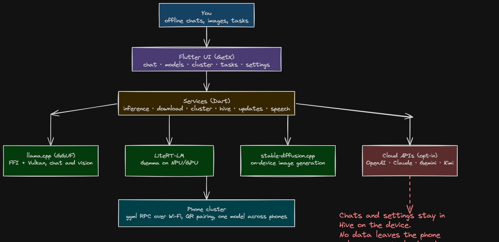
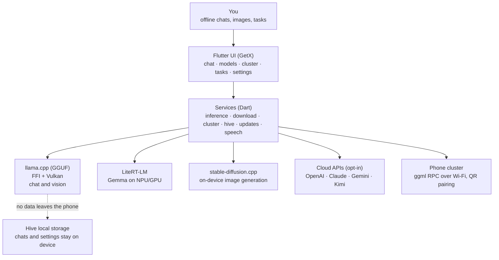
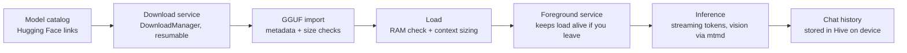
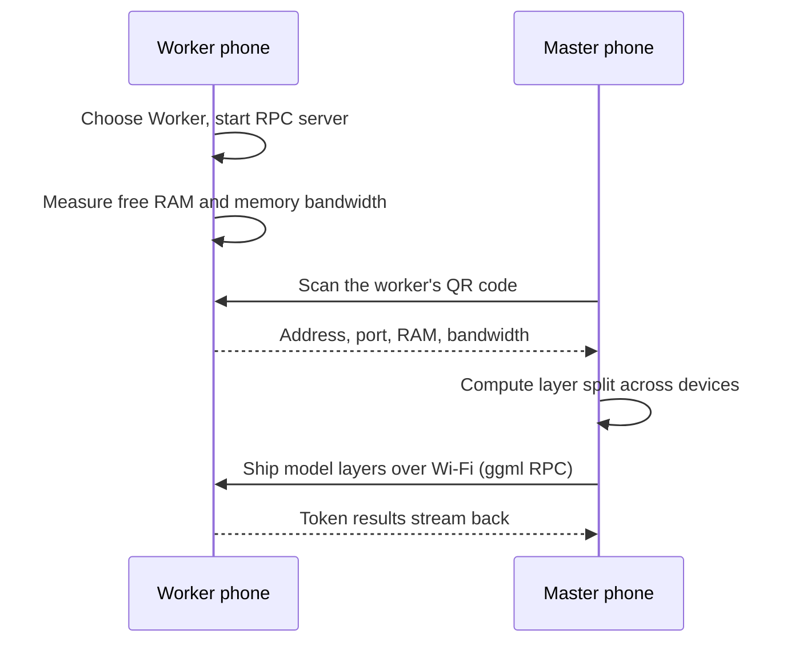

# PhoneLM

A cross-platform AI chat client built with Flutter. Run GGUF models directly on your phone with GPU-accelerated (Vulkan) inference, with no internet needed after download, or switch to cloud APIs (OpenAI, Anthropic, Gemini, Kimi) when you want more power. Everything local runs on the device: the model, the conversation, the generated images.



## What It Does

- **Local on-device inference (Android)**: download and run GGUF models on the phone using llama.cpp with Vulkan acceleration. Fully offline afterwards.
- **Second local backend**: Gemma through LiteRT-LM on NPU/GPU for supported devices.
- **Cloud API fallback (opt-in)**: one tap to OpenAI, Anthropic Claude, Google Gemini, or Kimi (Moonshot AI). Cloud is never the default.
- **Multimodal chat**: send text and images. Vision works with local models (Qwen2-VL style GGUF via mtmd) and with cloud providers.
- **Image generation**: local Stable Diffusion on-device, tested across Snapdragon, MediaTek, and Tensor devices.
- **Phone cluster**: run one GGUF model spread across several phones and tablets on the same Wi-Fi. Phones pair by scanning a QR code; each device runs the ggml RPC server.
- **OpenAI-compatible local server**: expose the loaded on-device model over an HTTP API for other apps on the network.
- **Speech to text**: dictate prompts with the microphone, processed by the system speech service.
- **Document extraction**: pull text out of PDFs and archives locally to use as chat context.
- **Private by default**: chats and settings are stored locally in Hive. Nothing leaves the device unless you explicitly pick cloud mode.
- **Smart auto configuration**: detects device RAM on first launch and recommends context size and token limits.
- **In-app updates**: new versions are discovered from GitHub Releases for sideloaded installs. Play installs update through the store.

## Architecture

The app is a Flutter client with three local inference engines behind one Dart service layer. Everything user facing runs in the app process; the cluster worker runs in its own process.



### Model lifecycle



### Cluster pairing and split inference



### Hand drawn diagram

The diagram at the top of this file is kept as an editable Excalidraw source at [`docs/architecture.excalidraw`](docs/architecture.excalidraw). Open it at [excalidraw.com](https://excalidraw.com) or with the Excalidraw VS Code extension to edit it, then export a PNG back into `docs/`.

## Stack

| Layer | Choice |
| --- | --- |
| Framework | Flutter (Dart SDK >= 3.3) |
| State management | GetX |
| Local storage | Hive |
| Networking | Dio + package:http |
| Text inference | llama.cpp via `llama_flutter_android` (FFI, Vulkan, mtmd vision) |
| Second backend | LiteRT-LM via `flutter_litert_lm` |
| Image generation | stable-diffusion.cpp via `sd_flutter_android` |
| Background work | `flutter_background_service` + `flutter_local_notifications` |
| Notifications | `flutter_local_notifications` (progress and completion) |
| Crash reporting | Firebase Crashlytics (conditional, only with `google-services.json`) |
| Push | Firebase Messaging (conditional) |
| QR pairing | `qr_flutter` (display) + `mobile_scanner` (scan) |
| Speech | `speech_to_text` |
| Documents | `syncfusion_flutter_pdf` + `archive` |

## Project Layout

```
lib/
  controllers/   GetX controllers (chat, model, cloud, cluster, tasks, settings)
  services/      Inference, download, cluster, hive, updates, image generation,
                 document extraction, OpenAI-compatible server, crash reporting
  views/         Chat, models, cluster, tasks, server, settings, logs
  models/        AI model, chat message, chat session, task
  core/          Theme, colors, routes, constants, redaction
  widgets/       Shared UI components
local_plugins/
  llama_flutter_android/   llama.cpp engine plugin (JNI + C++), cluster worker service
  sd_flutter_android/      stable-diffusion.cpp engine plugin (JNI + C++)
  flutter_litert_lm/       LiteRT-LM backend plugin
android/  ios/  macos/  web/    Platform shells
.github/workflows/              Release CI: signed APKs, AAB, mapping file
docs/                           Editable Excalidraw diagram source and exported image
```

## Building

1. Install Flutter and Android Studio.
2. `flutter pub get`
3. `flutter run` (Android), or build a release:
   - `flutter build apk --release --split-per-abi`
   - `flutter build appbundle --release` for the Play Store bundle.

Notes:

- Android builds apply Firebase only when `android/app/google-services.json` exists. The app runs fine without it.
- Model files (`.gguf`) are downloaded inside the app from Hugging Face, or imported from a folder through the system file picker.
- Release builds are code signed; `android/key.properties` (see `android/key.properties.example`) is required, or the build fails fast instead of shipping a debug-signed bundle.
- The release workflow publishes per-ABI APKs, the AAB, and the R8 mapping file to GitHub Releases on every version tag.

## Play Store Compliance

The Android app declares `FOREGROUND_SERVICE_DATA_SYNC` for one purpose: keeping on-device AI work (model loading and inference, image generation, cluster serving) alive while the user is away from the app. Each of those tasks shows a persistent notification the user can see and stop. No foreground service is started from boot, and no data is uploaded by the service. The declaration on record covers local processing only.

## Roadmap

- [x] Play Store closed testing release
- [x] R8 code shrinking with keep rules for the native engine plugins
- [ ] Native libraries aligned for 16 KB memory page devices
- [ ] iOS App Store build
- [ ] Task view for structured multi-step AI workflows

## Privacy

PhoneLM stores chats, settings, and model files on the device. Local inference happens on the device's own processor. The only network traffic the app generates is the traffic you ask for: model downloads, cloud provider calls when you select a cloud model, and update checks against GitHub Releases. The full policy lives in [PRIVACY.md](PRIVACY.md).

## License

MIT, see [LICENSE](LICENSE).
